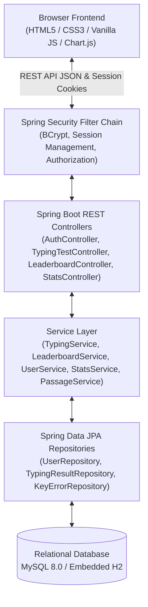
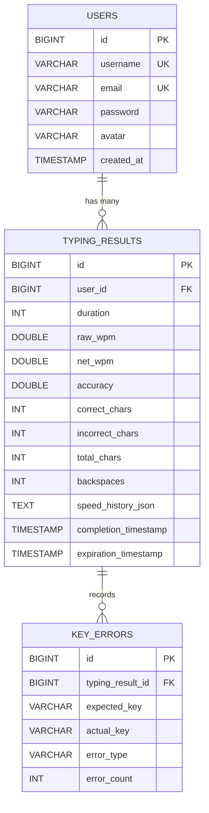

# TypeFlow — A Premium Typing Speed Test & Performance Analytics Platform

> **Tagline:** Every keystroke counts.  
> **Project Type:** College Microproject — Full-Stack Typing Speed Test and Performance Analytics Platform.  
> **Core Technology:** Java 17+ with Spring Boot 3.3.4, Spring Security, Spring Data JPA, MySQL / H2 Engine, HTML5, CSS3, JavaScript (Vanilla), and Chart.js.

---

## Table of Contents
1. [Project Title & Description](#1-project-title-and-description)
2. [Problem Statement](#2-problem-statement)
3. [Project Objectives](#3-project-objectives)
4. [Existing-System Limitations](#4-existing-system-limitations)
5. [Proposed-System Features](#5-proposed-system-features)
6. [Technologies Used](#6-technologies-used)
7. [System Architecture](#7-system-architecture)
8. [Database Schema and Relationships](#8-database-schema-and-relationships)
9. [WPM and Accuracy Formulas (with Worked Example)](#9-wpm-and-accuracy-formulas-with-worked-example)
10. [API Endpoint Documentation](#10-api-endpoint-documentation)
11. [Setup Instructions](#11-setup-instructions)
12. [Database Configuration (MySQL & Embedded Fallback)](#12-database-configuration)
13. [How to Run the Application in VS Code](#13-how-to-run-the-application-in-vs-code)
14. [Sample Test Scenarios](#14-sample-test-scenarios)
15. [Expected Outputs](#15-expected-outputs)
16. [Security & Fairness Features](#16-security-and-fairness-features)
17. [Limitations and Future Scope](#17-limitations-and-future-scope)

---

## 1. Project Title and Description

**TypeFlow** is a modern, high-precision typing speed test and analytics web application inspired by the typing mechanics of 10FastFingers and Monkeytype, combined with the competitive depth of a gaming dashboard and productivity analytics suite.

Unlike static frontend prototypes or toy college scripts, TypeFlow is an end-to-end full-stack platform built with **Java (Spring Boot)** as the core backend engine. It features independent server-side validation of scores, persistent user accounts with secure password hashing, real-time keyboard event heatmaps (distinguishing character substitution from omission/insertion), and a **rolling 24-hour competitive leaderboard** where only scores achieved in the preceding 24 hours qualify for active rankings.

---

## 2. Problem Statement

Most existing typing test websites suffer from key shortcomings:
1. **Client-Side Vulnerability:** Many web-based typing tests calculate and submit scores entirely on the client side, allowing users to modify JavaScript variables or inject arbitrary WPM values via browser developer tools.
2. **Coarse Error Tracking:** Typical platforms count only gross mistakes or completed words. They do not diagnose *why* a typist failed—failing to track physical finger misplacements (e.g., expecting `E` but striking adjacent `R`).
3. **Stale Leaderboards:** Traditional leaderboards quickly become dominated by historical outlier scores or bot scripts from years ago, discouraging new typists from competing.
4. **Disconnection from Deep Analytics:** Typists rarely receive actionable feedback regarding their weakest fingers, substitution patterns, or speed stability over the duration of a test.

---

## 3. Project Objectives

- **Develop a Robust Java Spring Boot Backend:** Implement a clean MVC/REST architecture handling authentication, validation, persistence, and leaderboard calculations.
- **Implement Standardized Character-Based Scoring:** Enforce the international 5-character word standard for raw WPM, net WPM, and character accuracy with server-side validation.
- **Deliver an Interactive QWERTY Heatmap:** Visualize keystroke mistakes on an interactive virtual keyboard, distinguishing Case A (character substitution) and Case B (omissions, insertions, and backspaces).
- **Maintain a Rolling 24-Hour Competitive Leaderboard:** Enforce a rolling 24-hour eligibility window where scores expire from active rankings after 24 hours while remaining in the user's personal history.
- **Provide Rich Visual Aesthetics:** Create a dark-mode-first aesthetic with electric mint accents, smooth transitions, Chart.js analytics, and optional Web Audio API mechanical sound effects.

---

## 4. Existing-System Limitations

| Feature | Existing Systems (e.g., Simple Online Tests) | TypeFlow Platform |
| :--- | :--- | :--- |
| **Backend Engine** | Static client-side JS or serverless functions | Full Java Spring Boot MVC backend with Spring Security & JPA |
| **Score Validation** | Blindly trusts client-submitted WPM values | Independent server-side formula re-calculation & anti-cheat rate limiting |
| **Error Diagnostics** | Binary right/wrong word counts | Key-by-key expected vs. actual keystroke heatmap with substitution pairs |
| **Leaderboard Dynamics**| Permanent all-time boards dominated by ancient/bot scores | Rolling 24-hour active leaderboard with countdown timers |
| **Data Persistence** | LocalStorage only or third-party cloud | Relational MySQL database with normalized foreign keys and H2 fallback |
| **Typing Audio** | Heavy audio files or none | Zero-dependency procedural Web Audio API mechanical switch synthesizer |

---

## 5. Proposed-System Features

1. **Test Modes:**
   - **30 Seconds (Quick Sprint):** High-speed reflex challenge.
   - **1 Minute (Classic Test - Default):** The standard benchmark balancing speed and consistency.
   - **2 Minutes (Endurance Test):** Sustained focus measuring stamina and error fatigue.
2. **Typing Engine:**
   - Real-time character highlighting (untyped, current glowing cursor, correct mint, incorrect red underline).
   - Stable countdown based on actual elapsed time (`performance.now()`).
   - Seamless passage replenishment: never cuts off faster typists before the timer expires.
   - Clipboard paste prevention for fairness.
3. **Interactive Realistic Keyboard Heatmap:**
   - Realistic QWERTY layout with physical key styling.
   - Color coded: Green/Mint (≥95% accuracy), Yellow (80–94%), Red (<80%), Neutral Gray (untested).
   - Hover & click tooltips showing times expected, correct presses, error presses, and common substitutions.
4. **Rolling 24-Hour Leaderboard:**
   - Rankings calculated dynamically by server queries (`completionTimestamp >= now - 24 hours`).
   - Deduplicated: only each user's best qualifying attempt in the window is ranked.
   - Tie-breakers: Highest Accuracy first, followed by earlier completion timestamp.
5. **Personal Analytics & History:**
   - Lifetime KPI cards (Personal Best, Average WPM, Best Accuracy, Total Tests).
   - Mode breakdown (30s vs 60s vs 120s).
   - Chart.js WPM progression and accuracy trends over time.
   - Test history table with modal inspection of past heatmaps.
   - User account and data deletion capabilities.
6. **Guest Mode & Frictionless Claim:**
   - Unregistered visitors can take unlimited tests.
   - A single click allows claiming their guest score upon registration or login.

---

## 6. Technologies Used

- **Backend:** Java 17+, Spring Boot 3.3.4 (Spring Web, Spring Security, Spring Data JPA, Hibernate, Jakarta Validation).
- **Frontend:** HTML5, Vanilla CSS3 (Custom Design System, Dark/Light Themes), JavaScript (ES6+ Modules).
- **Visualizations:** Chart.js 4.4.2 (Line charts for speed history and accuracy trends).
- **Audio:** Web Audio API (procedural synthesis of mechanical keyboard switches).
- **Database:**
  - **Production:** MySQL 8.0+ via `mysql-connector-j`.
  - **Development / Fallback:** File-backed embedded H2 engine (turnkey execution).
- **Build Tool:** Apache Maven 3.9+ (includes `mvnw.cmd` and `mvnw`).

---

## 7. System Architecture

TypeFlow follows a decoupled Layered Model-View-Controller (MVC) architecture:



### Keystroke Data Flow:
1. The typist initiates keystrokes; `typing-engine.js` records elapsed time, correct chars, incorrect chars, and key-level substitution events.
2. At timer expiration, payload is submitted via `POST /api/test/submit`.
3. `TypingService.java` validates raw counts, recalculates WPM and accuracy on the server side, checks anti-cheat thresholds, and persists the result to `typing_results` and `key_errors`.
4. `LeaderboardService.java` dynamically calculates qualifying 24-hour rankings based on server-side timestamps.

---

## 8. Database Schema and Relationships



### Table Definitions:
1. **`users`**: Stores user authentication credentials, unique usernames/emails, BCrypt password hashes, and initial avatars.
2. **`typing_results`**: Stores verified typing test attempts, duration (30, 60, 120s), calculated speeds, character counts, and the 24-hour expiration timestamp (`completion_timestamp + 24h`).
3. **`key_errors`**: Normalized table containing detailed keystroke diagnostics (e.g., expected character `e`, typed character `r`, error type `CASE_A_SUBSTITUTION`, count `3`) to reconstruct heatmaps across any individual or historical test.

---

## 9. WPM and Accuracy Formulas with Worked Example

TypeFlow strictly adopts the international standard **5-character definition of one word**:

$$\text{Raw WPM} = \frac{\text{Total Characters Typed} / 5}{\text{Elapsed Time in Minutes}}$$

$$\text{Net WPM} = \frac{\text{Correct Characters Typed} / 5}{\text{Elapsed Time in Minutes}}$$

$$\text{Accuracy (\%)} = \left(\frac{\text{Correct Characters Typed}}{\text{Total Characters Typed}}\right) \times 100$$

### Worked Example:
- **Scenario:** A user participates in a **1-minute (60 seconds = 1.0 min)** test.
- **Keystrokes:** The user types **600 total characters**.
- **Results:** **566 characters** are correct; **34 characters** are incorrect.
- **Calculations:**
  - $\text{Raw WPM} = (600 / 5) / 1.0 = \mathbf{120.0 \text{ WPM}}$
  - $\text{Net WPM} = (566 / 5) / 1.0 = \mathbf{113.2 \text{ WPM}}$
  - $\text{Accuracy} = (566 / 600) \times 100 = \mathbf{94.33\%}$

*Note on Partial Tests:* If a test is prematurely terminated, the actual elapsed time in minutes ($t_{\text{seconds}} / 60$) is used as the denominator, preventing division by zero through backend validation.

---

## 10. API Endpoint Documentation

| Method | Endpoint | Access | Description |
| :--- | :--- | :--- | :--- |
| `POST` | `/api/auth/register` | Public | Register new user and establish session cookie. |
| `POST` | `/api/auth/login` | Public | Authenticate user via username/email and password. |
| `GET` | `/api/auth/status` | Public | Return current session profile or guest status. |
| `POST` | `/api/auth/logout` | Public | Invalidate HTTP session and clear cookie. |
| `POST` | `/api/auth/claim-guest` | User | Link an unauthenticated guest test result to current user. |
| `GET` | `/api/test/passage` | Public | Retrieve a random curated passage (`?excludeId=`). |
| `GET` | `/api/test/passage/next` | Public | Retrieve supplementary paragraph for seamless extension. |
| `POST` | `/api/test/submit` | Public | Validate and save typing test attempt (guest or user). |
| `GET` | `/api/test/result/{id}` | Public | Retrieve detailed result data including key error events. |
| `GET` | `/api/leaderboard` | Public | Retrieve 24-hour leaderboard (`?duration=30|60|120`). |
| `GET` | `/api/leaderboard/recent` | Public | Retrieve recent activity feed within the 24h window. |
| `GET` | `/api/stats/personal` | User | Retrieve lifetime KPIs, duration stats, and history. |
| `DELETE`| `/api/stats/result/{id}` | User | Delete a specific test result owned by the user. |
| `DELETE`| `/api/stats/all` | User | Clear all typing history for the authenticated user. |
| `DELETE`| `/api/stats/account` | User | Permanently delete user account and associated records. |

---

## 11. Setup Instructions

### Prerequisites:
- **Java SE Development Kit (JDK):** Version 17, 21, or 27.
- **Maven:** Bundled via `mvnw.cmd` / `mvnw` (or standalone Maven 3.9+).
- **Web Browser:** Any modern browser (Chrome, Edge, Firefox, Safari).

### Clone & Build:
```bash
# Navigate to the project root
cd d:/TypeFlow

# Verify compilation and run all 12 automated unit tests
./mvnw.cmd test

# Package the production executable JAR
./mvnw.cmd package
```

---

## 12. Database Configuration

TypeFlow provides dual-profile configuration:

### Option A: Out-of-the-Box Development Profile (Default)
By default, TypeFlow runs with an embedded persistent file-backed H2 engine stored at `./data/typeflow_db`.
- **Zero installation or external database required.**
- Data is safely persisted across restarts.
- H2 web console is available at `http://localhost:8080/h2-console` (JDBC URL: `jdbc:h2:file:./data/typeflow_db`, User: `sa`, Password: empty).

### Option B: MySQL 8.0+ Production Profile
To run with a local or remote MySQL instance:
1. Create the MySQL database:
   ```sql
   CREATE DATABASE typeflow_db CHARACTER SET utf8mb4 COLLATE utf8mb4_unicode_ci;
   ```
   *(Or execute the provided `schema.sql` script directly in MySQL Workbench / CLI)*.
2. Configure credentials via environment variables or run with the `mysql` profile:
   ```bash
   java -jar -Dspring.profiles.active=mysql -DDB_URL=jdbc:mysql://localhost:3306/typeflow_db -DDB_USERNAME=root -DDB_PASSWORD=your_password target/typeflow-1.0.0.jar
   ```

---

## 13. How to Run the Application in VS Code

1. Open the `d:\TypeFlow` folder in VS Code (`File > Open Folder...`).
2. If prompted, install the **Extension Pack for Java** and **Spring Boot Extension Pack**.
3. Open a terminal in VS Code (`Terminal > New Terminal` or `` Ctrl + ` ``).
4. Run the application using the Maven wrapper:
   ```powershell
   .\mvnw.cmd spring-boot:run
   ```
   *Alternatively, run the packaged JAR:*
   ```powershell
   java -jar target\typeflow-1.0.0.jar
   ```
5. Open your browser and navigate to:
   ```
   http://localhost:8080/
   ```

---

## 14. Sample Test Scenarios

### Scenario 1: Guest Typing Test & Passage Auto-Replenishment
1. Navigate to `http://localhost:8080/#test`.
2. Notice the status badge reads `Waiting to Start`.
3. Type the first letter: the countdown timer immediately starts ticking down from `1:00`.
4. Type rapidly past the initial sentences: observe additional curated sentences appending seamlessly without interruption.
5. Intentionally mistype letters: observe red highlight and mechanical error tone.
6. When timer reaches `0:00`, the test freezes and automatically redirects to the detailed results dashboard.

### Scenario 2: Heatmap Diagnostic & Substitution Inspection
1. On the Results screen, scroll down to the **Keystroke Heatmap Diagnostics**.
2. Hover over key `E`: the tooltip reveals how many times `E` was expected, correct presses, error presses, accuracy percentage, and if it was commonly replaced with `R` (Case A substitution).
3. Keys not tested remain in neutral slate gray.

### Scenario 3: Registration & Guest Score Claim
1. In the Results screen, click the **"Claim Score"** banner.
2. In the modal, enter username, email, and password (observe live password strength meter).
3. Upon submitting, the user account is created, logged in, and the guest test score is claimed and persisted.

### Scenario 4: Rolling 24-Hour Leaderboard Expiration
1. Open the Leaderboard tab (`#leaderboard`).
2. Notice qualifying scores appear with their rank, username, Net WPM, and countdown (`Xh Ym remaining`).
3. Historical scores older than 24 hours (such as the seeded test from 26 hours ago) are strictly excluded from the leaderboard, while remaining visible in personal history.

---

## 15. Expected Outputs

### Console Startup Output:
```
  .   ____          _            __ _ _
 /\\ / ___'_ __ _ _(_)_ __  __ _ \ \ \ \
( ( )\___ | '_ | '_| | '_ \/ _` | \ \ \ \
 \\/  ___)| |_)| | | | | || (_| |  ) ) ) )
  '  |____| .__|_| |_|_| |_\__, | / / / /
 =========|_|==============|___/=/_/_/_/
 :: Spring Boot ::                (v3.3.4)

...
Tomcat started on port 8080 (http) with context path '/'
Started TypeFlowApplication in 13.312 seconds
```

### Pre-Seeded Demonstration Accounts (for viva demonstration):
- **Username:** `demouser` | **Password:** `password123`
- **Username:** `alex_typist` | **Password:** `password123`

---

## 16. Security and Fairness Features

- **BCrypt Password Hashing:** All passwords are salted and hashed using Spring Security's `BCryptPasswordEncoder` (work factor 10). Plaintext passwords are never stored or logged.
- **Server-Side Validation:** The backend independently recalculates Raw WPM, Net WPM, and Accuracy from character counts and elapsed time. Client-tampered scores are recalculated or rejected.
- **Anti-Cheat Threshold:** Submissions exceeding 300 WPM (well above human world records) are automatically flagged and rejected.
- **Session Security:** Standard `HttpOnly` session cookies with `SameSite=Lax` prevent cross-site scripting (XSS) session hijacking.
- **Input Sanitization:** Entity-level JPA parameterization completely prevents SQL injection attacks.
- **Privacy Preservation:** Public leaderboard queries strictly project only usernames, avatars, and test metrics—never exposing emails, passwords, or private IDs.

---

## 17. Limitations and Future Scope

### Limitations:
- Single-language focus (curated English corpus).
- Local audio synthesis depends on browser HTML5 Web Audio API support.

### Future Scope:
- **Multi-Language Datasets:** Incorporating Spanish, French, German, and programming syntax modes (Java, Python, C++, JavaScript).
- **Real-Time Multiplayer Head-to-Head:** Adding WebSocket STOMP rooms allowing typists to race against each other in real-time with visual ghost cursors.
- **Custom Passage Uploads:** Permitting users to paste or upload custom literature or code files for specialized practice.
- **OAuth2 Social Sign-In:** Integrating Google and GitHub authentication.

---

### Project Metadata
- **Project Name:** TypeFlow
- **Author:** Hitakshi Bhanushali
- **Academic Context:** College Microproject — Typing Speed Test and Performance Analytics Platform
- **License:** MIT License
